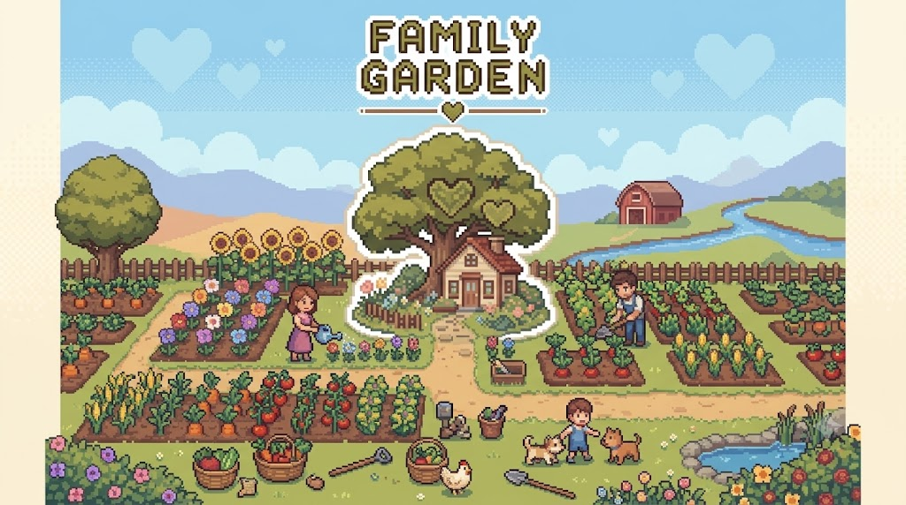
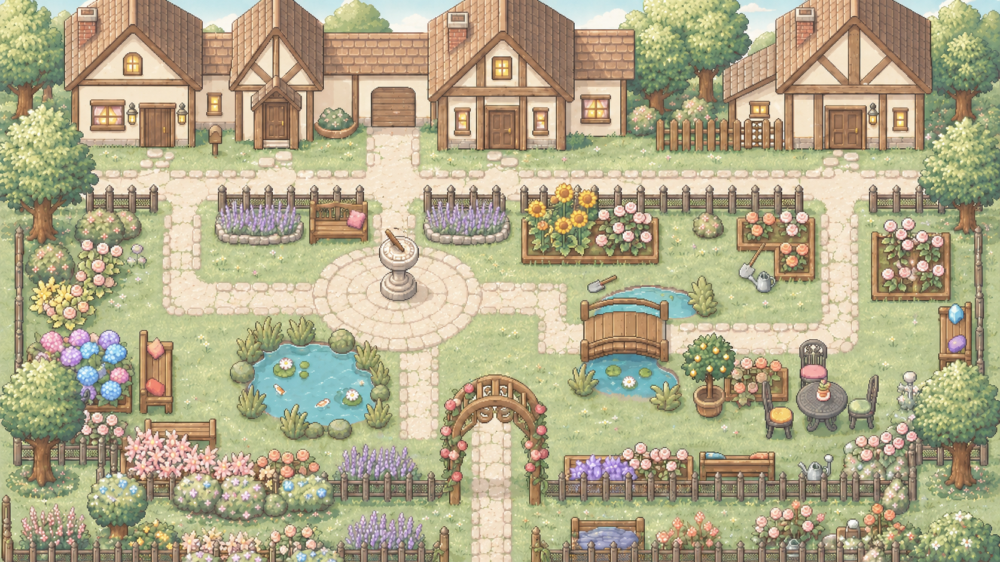

# Family Garden

> Let family memories grow into a garden where you can spend time together, explore, and connect.



Family Garden is an AI-powered pixel-art life simulation game for families. Players can save photos and stories
and spend time together in a garden, shared farm, fishpond, and kitchen. AI helps organize the content they provide
and generate gentle conversation prompts and recipes, without inventing family relationships or experiences.

## Play Online

**Web version: <https://familygarden-d7gy18huh87fd41d2-1449262000.tcloudbaseapp.com/>**

- Use the latest version of Chrome, Edge, or Firefox for the best experience.
- Click the entry button on the launch page (meaning “Enter Family Garden”) to enable game audio in your browser.
- Core single-player gameplay is available to try right away.
- Live AI, member identity, cloud sync, and online multiplayer require Tencent CloudBase services and available quota.
- Use the permanent HTTPS address above when sharing, demonstrating, or submitting the project, without temporary query parameters.

## Why We Are Building This

For many families, the challenge is finding a natural way to start a conversation. Photos are scattered across
albums and chat histories, while stories from older relatives, shared trips, and everyday moments rarely get
recorded and expanded over time.

Family Garden brings these conversations into light, playful activities, without asking anyone to conduct a formal “family interview”:

```text
Record a memory
  → AI organizes it into an editable memory card
  → Family members add answers and shared details
  → Memory flowers and vines linking memories grow in the garden
  → New interactions unfold on the farm, by the fishpond, in the kitchen, and in rooms
```

AI serves as a memory-organizing assistant, not a storyteller. It only processes content that players choose
to provide. It does not infer family relationships, judge feelings, or present generated content as real family facts.

## What You Can Play Today

| Feature | Current experience |
|---|---|
| Three-chapter story | Reopen the garden, discover the shared farm, then gather in the kitchen and around the family table |
| Family garden | Record memories, view photo cards, grow a landscape of memory flowers, and decorate your garden |
| Shared farm | Choose seeds, plant, water, grow, harvest, and interact with livestock pen gates |
| Fishpond | Go fishing, discover message-in-a-bottle questions, share memories through answers, and explore the waterside |
| New kitchen | Walk around the kitchen, share ingredients, cook interactively, and serve dishes |
| Family map | Travel between the garden, farm, fishpond, kitchen, and rooms |
| Characters | Customize appearances and nicknames, manage family identities, and see who is online |
| Accessibility | Care Mode enlarges text and UI without reducing the visible game area |
| Web version | A 1280×720 logical canvas, responsive display, and a launch page that enables audio |



## AI and Cloud Features

### AI Workflows

- Generate editable memory cards from photos or text.
- Suggest open-ended, low-pressure family questions based on existing memories.
- Generate recipes using ingredients in the family's shared storage.
- Identify visible objects and areas in room photos.
- Suggest questions about possible connections between two confirmed memories.
- Validate all AI output against JSON Schema before it enters the game state.

### Safety Boundaries

- AI never outputs world coordinates.
- Room analysis returns only `object_type + zone`.
- Godot builds scenes from an allowlisted catalog; the model cannot control nodes directly.
- Authentication, invalid-input, and content-safety errors are never disguised as successful live responses by mocks.
- Network or model failures may use an explicit fallback, with the result's source recorded.
- Never commit Tencent Cloud credentials, AI API keys, service role keys, or member tokens to the repository.

### Cloud Identity

When a device first joins a family, it receives its own `member_token` through `data_gateway`. The token is stored
only in that device's `user://cloud_identity.json` and is used to resolve `family_id` and `member_id`. Live AI requests,
family sync, and online presence all depend on this identity flow.

## Technical Architecture

```text
Godot 4.7 Web / Desktop
  ├─ SceneManager          Scenes, travel, and the main game flow
  ├─ MemoryManager         Memories and local saves
  ├─ InventoryManager      Inventory, shared storage, and cooking ingredients
  ├─ AIClient              State, validation, caching, cancellation, and fallback
  ├─ AIWorkflowManager     AI drafts, confirmation, persistence, and compensation
  ├─ CloudService          Identity, family data, and sync
  └─ PresenceChannel       Online members and scene events
           │
           ├── CloudBase AI Gateway ── Content safety ── Tencent Hunyuan / TokenHub
           ├── CloudBase Data Gateway ── Data isolated by family and member identity
           ├── CloudBase Storage ── Family photos and temporary uploads
           └── Presence Relay ── WebSocket presence

Static Web Build
  └── Tencent CloudBase Static Hosting / CDN
```

## Run Locally

### Requirements

- Godot `4.7.stable`
- Compatibility renderer
- Recommended desktop resolution: at least 1280×720

### Getting Started

1. Clone the repository.
2. Import `game/project.godot` in Godot.
3. Run the main scene.
4. Move with WASD or the arrow keys, and press `E` to interact with objects.

```bash
git clone https://github.com/peilinpeng/family-garden-dev.git
cd family-garden-dev
open game/project.godot
```

Public project endpoints are configured in `game/config/`. Personal member tokens are stored in `user://` and are
never included in the source repository. If CloudBase is disabled or its quota is unavailable, core local gameplay
still works, but live AI, member identity, and cloud collaboration are unavailable.

## Local Tests

On the first run, install dependencies for the three Node workspaces and create an ignored `.venv` at the repository root:

```bash
./tools/test_all.sh --bootstrap
```

Use the same entry point for routine full regression testing:

```bash
./tools/test_all.sh
```

The script runs all Godot test scenes, AI Gateway Node tests, Gate 1 Python JSON Schema contract tests,
Data Gateway tests, and Presence Relay tests. It uses only local mocks and never calls live AI, CloudBase,
online Presence services, or paid APIs.

The project requires Godot 4.7 and Node.js 20.19+. On macOS, the script automatically detects
`/Applications/Godot.app/Contents/MacOS/Godot`; on other systems, set `GODOT_BIN` to the executable path.
Failure logs are kept in the temporary directory printed by the script. Set `KEEP_TEST_LOGS=1` to retain
successful test logs as well.

Live cloud smoke tests call external services and may incur charges, so they are excluded from routine local regression tests.
For the M0 test scope and baseline results, see
[`docs/dev/60_m0_quality_baseline.md`](docs/dev/60_m0_quality_baseline.md).

## Continuous Integration

GitHub Actions runs the “M3 Quality Gate” on pushes to `main`, `dev`, and `feature/**`, and on pull requests targeting
`main` or `dev`. The gate pins Godot, Node.js, and Python versions and runs the full local regression suite,
a critical-vulnerability audit of production dependencies, and a Web Release audit. It does not call live AI,
CloudBase, Presence services, or paid APIs.

When CI fails, test and export logs are retained for seven days. For trigger rules, safety boundaries, and maintenance, see
[`docs/dev/63_m3_ci_quality_gate.md`](docs/dev/63_m3_ci_quality_gate.md).

## Web Export

Before submitting changes to a Web release, run the standalone export audit:

```bash
./tools/check_web_export.sh
```

The script performs a Release export and checks the PCK size limit, dynamically loaded resources, production exclusions,
and startup of the exported build. It does not access online services and requires the Godot 4.7 Web export templates
to be installed locally.

```bash
/Applications/Godot.app/Contents/MacOS/Godot \
  --headless --path game \
  --export-release Web ../export_web/index.html
```

The project uses `game/web/family_garden_web_shell.html` as its custom Web shell to:

- Enable browser audio playback after a user click.
- Preserve the correct aspect ratio of the 1280×720 game canvas.
- Reassemble split PCK/WASM files to accommodate EdgeOne's per-file size limit.

`export_web/`, `.edgeone/`, and `.tef_dist/` are build artifacts and are excluded from the source repository.

For M2 asset tradeoffs, size comparisons, and acceptance records, see
[`docs/dev/62_m2_web_export_optimization.md`](docs/dev/62_m2_web_export_optimization.md).

To preview locally:

```bash
npx vite export_web --host 127.0.0.1 --port 4173
```

## Repository Structure

```text
game/
  assets/        Game art, fonts, audio, and TileSets
  config/        Public endpoint configuration safe to commit
  scenes/        Godot scenes
  scripts/       Game systems, managers, and UI
  tests/         Godot regression tests
  web/           Custom Web shell

backend/
  ai/            AI Gateway, contracts, content safety, and provider adapters
  cloudbase/     Data gateway, presence relay, and cloud scripts
  mocks/         Local mocks for AI features

docs/
  dev/           Collaboration, handoff, and acceptance records
  submission/    Competition overview, demo materials, and screenshots
```

## Project Status and Limitations

- Development follows the `feature/* → dev → main` collaboration model.
- The new kitchen, `KitchenNew.tscn`, has replaced the previous kitchen scene.
- Semantic room generation retains its own room TileSet and does not depend on the previous kitchen scene.
- Selecting photos on the Web requires browser file permissions.
- `user://` data is affected by browser IndexedDB support, private browsing, and site storage permissions.
- When CloudBase functions are unavailable, the Web version cannot obtain member identities or call live AI.
- Web audio requires a real user click on the launch page.

## Documentation and Collaboration

- Product and demo: [`docs/README.md`](docs/README.md)
- Competition submission materials: [`docs/submission/README.md`](docs/submission/README.md)
- AI interface contracts: [`docs/04_ai_interfaces.md`](docs/04_ai_interfaces.md)
- Backend data model: [`docs/05_backend_data_model.md`](docs/05_backend_data_model.md)
- Coordinate and art specifications: [`docs/09_godot_coordinate_art_spec.md`](docs/09_godot_coordinate_art_spec.md)
- Contribution guidelines: [`CONTRIBUTING.md`](CONTRIBUTING.md)
- AI collaboration rules: [`AGENTS.md`](AGENTS.md)

---

Family Garden hopes to turn family conversations from something that takes courage to begin into a garden you can nurture over time.
